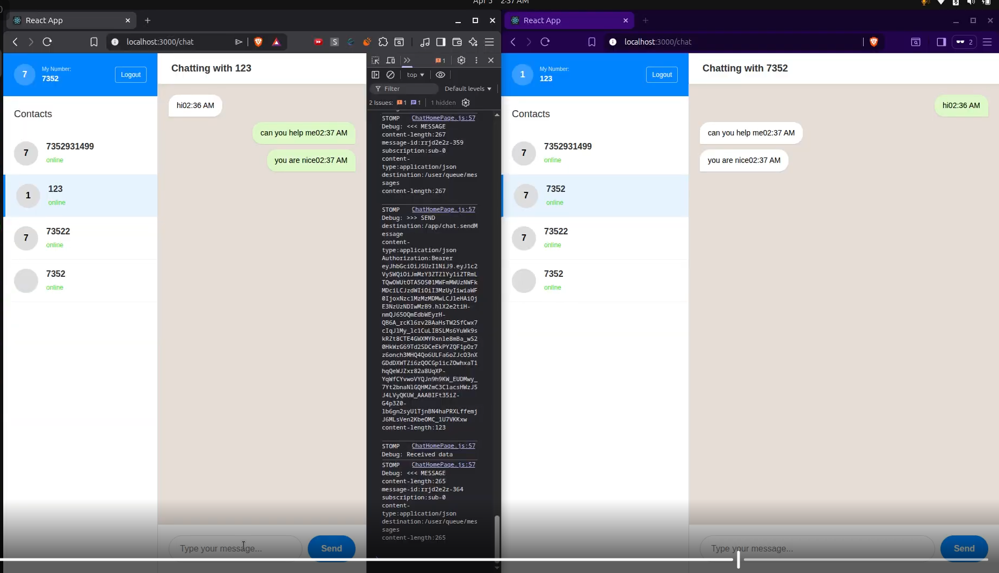

# Real-Time Microservices Chat Platform

A cloud-native, real-time chat platform built with **Spring Boot 3**, **React**, **MongoDB Atlas**, and **WebSockets (STOMP)**. Fully containerized and deployed on **AWS ECS Fargate** using **Terraform (IaC)** and automated through **GitHub Actions (CI/CD)**.

---

## 🏗️ Architecture & AWS Infrastructure

The application follows an event-driven microservices architecture using direct **AWS Application Load Balancer (ALB)** path-based routing, eliminating gateway latency and server overhead.

```text
                               +----------------------------------+
                               |  AWS Application Load Balancer   |
                               +----------------------------------+
                                                |
          +-------------------------------------+-------------------------------------+
          |                                     |                                     |
   (Path: /*)                           (Path: /api/v1/auth/*)               (Path: /api/v1/chat*, /ws*)
          |                                     |                                     |
          v                                     v                                     v
+------------------+                   +------------------+                   +------------------+
| Frontend Service |                   |   Auth Service   |                   |   Chat Service   |
| (Nginx / React)  |                   |  (Spring Boot)   |                   |  (Spring Boot)   |
+------------------+                   +------------------+                   +------------------+
                                                                                        |
                                                                                        v
                                                                               +------------------+
                                                                               |  MongoDB Atlas   |
                                                                               +------------------+
```

---

## 🚦 ALB Path Routing Matrix

| Service | Target Port | ALB Path Patterns | Description |
| :--- | :--- | :--- | :--- |
| **Frontend** | `80` | `/*` (Default) | Serves compiled static React SPA via Nginx container. |
| **Auth Service** | `8081` | `/api/v1/auth/*` | Handles OTP generation, verification, and JWT issuance. |
| **Chat Service** | `8082` | `/api/v1/chat*`, `/api/v1/users*`, `/ws*` | Manages messaging, user profiles, and STOMP WebSockets. |

---

## 🛠️ Tech Stack

- **Backend:** Spring Boot 3, Spring Security (Stateless JWT), Spring Data MongoDB, WebSocket (STOMP)
- **Frontend:** React, SockJS / STOMP Client, Nginx
- **Database:** MongoDB Atlas
- **Cloud Infrastructure (AWS):** ECS Fargate, Application Load Balancer (ALB), ECR, VPC, Subnets, SSM Parameter Store
- **Infrastructure as Code (IaC):** Terraform
- **CI/CD Pipeline:** GitHub Actions (Maven builds, multi-stage Docker containerization, ECR push, zero-downtime ECS rolling updates)

---

## 🔒 Security & Configuration

- **Stateless JWT Security:** Unified cross-service authorization with custom security filters.
- **Secrets Management:** Zero hardcoded credentials; environment variables dynamically fetched from **AWS SSM Parameter Store** at container startup.
- **ALB Health Monitoring:** Dedicated `/actuator/health` endpoint checks for ECS automated task recovery.

---

## 🚀 CI/CD & Infrastructure Provisioning

### Automated CI/CD (GitHub Actions)
Every commit pushed to `main` automatically triggers the GitHub Actions workflow:
1. **Build & Test:** Compiles Maven artifacts and builds React production bundles.
2. **Containerize:** Creates optimized multi-stage Docker images and pushes them to **AWS ECR**.
3. **Deploy:** Executes `aws ecs update-service` for zero-downtime rolling deployments.

### Infrastructure Provisioning (Terraform)
To spin up or update the full AWS infrastructure:

```bash
cd terraform
terraform init
terraform plan
terraform apply -auto-approve
```

---

## 📹 Demo

[](https://drive.google.com/file/d/1GrhMoxBJlxVK7mteAksNpTOxIUWBcHky/view?usp=drive_link)
